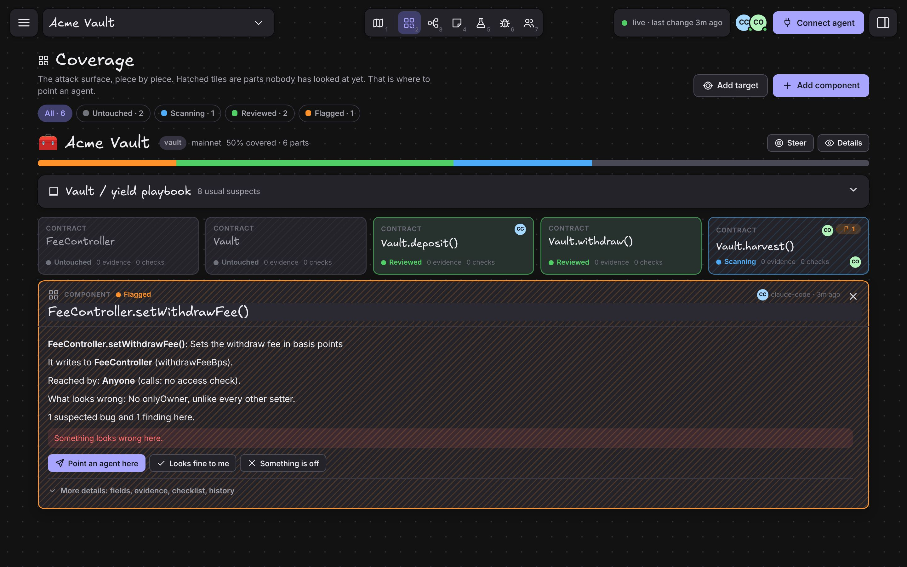
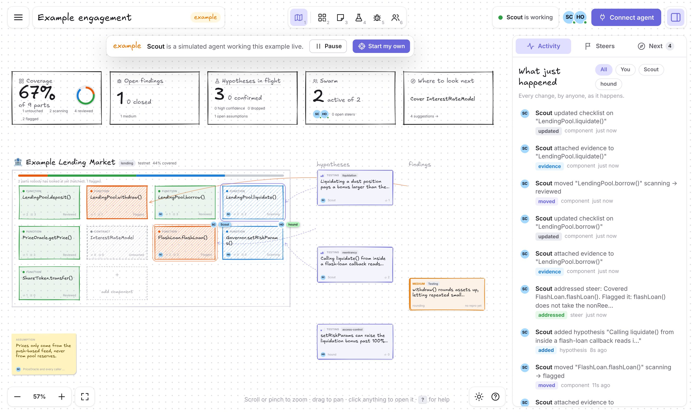

# recon

**I can actually work with my agent on security research, and this is the best harness for it.**

recon is a shared cockpit where you and one or more AI agents hunt vulnerabilities
together. Today an agent doing security research works alone in the dark: you
can't see its progress, can't check what it did, and can't hand it the
"wait, what about…" idea that lands the finding. recon makes the hunt a shared,
live, human-readable board. The agents do the tireless scanning, you bring
intuition and judgement, and each side sees the other's work as it happens.

## Start in one line

**Paste this into any coding agent** (Claude Code, OpenCode, Grok CLI, Codex, Gemini CLI, Cursor, anything with a terminal):

```
Run `npx -y github:devIykee/recon agent` and follow its instructions to do this security review with me on the recon board.
```

That's it: no install, no config, no restart. The agent starts the board in the
background, tells you where it is (http://127.0.0.1:4317), sets up the
engagement, and starts recording what it reviews, suspects and confirms. You watch,
verify, dispute and steer from the browser.

**Or install the tools once in your terminal**, so recon shows up as native MCP
tools in every agent you have:

```sh
npx -y github:devIykee/recon setup
```

It finds Claude Code, Codex, Gemini CLI, OpenCode, Cursor, Windsurf and Claude
Desktop, adds recon to each, and opens the board. (Grok CLI keeps MCP servers per
project: run `setup --here` inside the project.) Restart your agent and say
*"Use recon: call recon_briefing and work the board with me."*

One `recon` entry serves every project and every hunt: it picks the hunt from
the project the agent is working in, and an agent switches with
`recon_start_engagement`. If you added one entry per hunt earlier (`recon-szns`,
`recon-yeno`, …), `setup` lists them and `setup --clean` removes them.

Needs Node 20+. Zero dependencies. Everything stays on your machine, in `~/.recon`.

### Update

```sh
recon update            # or: ~/.recon/bin/recon update
```

It downloads the latest recon from GitHub, installs it in `~/.recon/app` and
restarts the board (your hunts are saved first). Every agent picks it up
without being restarted: the CLI runs the new code from its next command, and
agents connected over MCP switch to it within a few seconds, keep their hunt,
and are told their tool list changed. `recon update --check` only says whether
there is something new. (An MCP server started by a version from before this
existed needs its agent restarted once.)

### Tested with real agents

Against a small vulnerable vault, a Claude Code agent given only the line above
set up the engagement, mapped the attack surface, and found all three planted
bugs (reentrancy, an unprotected fee setter, first-depositor inflation) with
file:line evidence. It answered a steer left mid-run, and when its claim was
disputed it re-checked and downgraded it. A second agent joined over MCP,
challenged a trust assumption, and *proposed* a re-rating for a yes/no instead
of acting on its own. `recon setup` registration was checked against the real
Claude Code, OpenCode, Codex, Gemini CLI and Grok CLI binaries; Claude Code,
OpenCode and Grok also confirmed a live connection with all recon tools listed.


To try the built-in example without an agent: `npx -y github:devIykee/recon serve`.
It opens on an example engagement worked live by **Scout**, a simulated agent.

## What you get

**A map of the whole engagement.** Zoomed out, it is five blocks: coverage, open
findings, hypotheses in flight, the agents, and where to look next. Zoom in and
each target is a frame of components colored by review state. Hatched tiles are
parts nobody has looked at; that is where bugs hide. Hypotheses and findings sit
in lanes beside the target, assumptions are pinned below, and each agent's
marker walks to whatever it is working on. Click anything to expand it in place.

**Boards** for coverage, assumptions, hypotheses, the findings pipeline
(recon → testing → reported → acknowledged → fixed → disclosed, drag to move),
and agents.



**Verify, don't trust.** Every claim carries the evidence the agent attached:
the file and line, the function, the transaction, what it concluded and why.
The verdict is yours, not the agent's: *unverified*, *verified* or *disputed*.
Disputing a claim is loud on the board and automatically sends the agent that
made it a steer to revisit.

**Steer, don't supervise.** On any item or agent: re-check this, challenge this
assumption, cover this, verify this finding, raise or drop priority, leave a
note. A steer never stops an agent. It goes open → seen → done, the agent reports
back on the same item, and the card flips when it does.

**A knowledge layer.** Pick the protocol type (lending, AMM, perps, bridge,
staking, NFT market, governance, oracle, token, vault) and recon brings that
type's playbook: the exploit classes that usually bite, in plain words with a
"go deeper", and a checklist on every component. It suggests where to look next
from untouched surface, unverified assumptions, confident hypotheses without
evidence, and playbook gaps. One click turns a suggestion into a steer. Agents
get the same context in their briefing, so instead of idling or going rogue
they *propose* their next move for a quick yes or no. Security jargon is
explained on hover throughout.

**Swarms when you want them.** With a second agent the agents view becomes a
swarm board: what each agent is doing, who owns which component (so agents don't
trample each other), group steering, and health flags for agents that are idle,
stuck, looping, noisy, or often disputed. With one agent, none of this gets in
the way.


**Talk to agents from the board.** The Talk panel is a conversation with each
agent, or all of them. What you write reaches the agent with its next step, and
an agent that has finished or is blocked does not just stop: it calls
`recon_wait` (or `recon wait`) and listens, shown as *listening* on the board,
and wakes the moment you write. It answers in the same panel. You never have
to switch to its terminal.

**Your skills, and reports written your way.** Keep reusable instructions for
your agents under Skills (K): how you audit a kind of protocol, house rules,
and how you want disclosures written. They are stored once per machine as
Claude-style `SKILL.md` folders in `~/.recon/data/skills`, so you can import a
Claude skill as it is, and every agent sees them in its briefing and as MCP
prompts. The built-in *Disclosure report* skill is the system prompt the agent
writes reports with: plain prose for engineers and non-technical readers
alike, honest severity in the opening sentences, every claim paired with its
limits, what was checked and held, what was not reviewed, a concrete fix, and
your name at the end. The agent gets the facts from the board, writes, and
submits; markdown, a missing severity or a missing signature is sent back to
fix. You pick one combined document or one per finding.

**Live everywhere.** Every change from any agent, the API, or another tab
appears immediately, attributed and animated, in an activity feed you can filter
by author. Nothing needs a refresh.



## Four ways to connect

| | |
| --- | --- |
| **MCP** | `recon mcp --name my-agent`: 26 tools (briefing, scan and map, coverage, hypotheses, findings, steers, proposals, skills, the report…) and your skills as prompts. Starts a local hub if none is running. |
| **CLI** | `RECON_AGENT=my-agent recon briefing`, `recon coverage "Vault.withdraw()" reviewed --evidence "Vault.sol:120"`… |
| **HTTP + WebSocket** | REST writes with `X-Recon-Agent: my-agent`; a socket at `/ws` streams every change. |
| **Drop-in JSON** | `recon serve --watch inbox.json`: your agent writes a file and recon merges it item by item. |

Full reference: [docs/API.md](docs/API.md). Every entity, field and enum:
[docs/MODEL.md](docs/MODEL.md).

## How it holds together

- **One hub, many writers.** The hub serves the UI, the API, the WebSocket and
  MCP, and is the single serialization point for every writer. That was a
  deliberate choice over a shared JSON file or a CRDT in the browser: it gives one
  ordering of events, real-time fan-out, and one place to enforce rules.
- **Per-field writes.** Each field is a last-write-wins register stamped with who
  wrote it and when. Human-owned fields (verification, priority, assignment) are
  separate from agent-owned ones (review state, evidence, reasoning, status), so
  collisions are rare. When two writers do touch the same field, only that field
  is affected and the change glows on every screen. Evidence merges by id and
  checklists merge per item, so concurrent additions never clobber each other.
- **Ownership.** Agents claim components (starting to scan one claims it), and
  another agent can only add evidence there.
- **Local-first.** By default the hub binds to localhost, keeps data in
  `~/.recon`, works offline, refuses foreign Host headers and cross-origin writes,
  and serves a strict CSP. Findings and embargoed disclosures never leave your
  machine.

## Reach your local board from anywhere (ngrok)

recon runs on your machine by default, so only agents on that machine can reach
it. To let an agent or LLM somewhere else connect (a cloud agent, a second
computer, an LLM client that takes a remote MCP server), put the hub behind a
tunnel such as [ngrok](https://ngrok.com). A tunnel puts your board on the
internet, so run it in server mode, which requires a key:

```sh
pkill -f 'recon.js serve'                          # stop the board agents started in the background, if any
export RECON_KEY="$(openssl rand -hex 24)"          # the password for the board; keep it secret
ngrok http 4317                                    # note the https://<name>.ngrok-free.app address it prints
RECON_ALLOWED_HOSTS=<name>.ngrok-free.app,localhost,127.0.0.1 \
  recon serve --mode server                        # serve your existing board, now keyed
```

It serves the same hunts from the same data folder; only one board may run on
it at a time. Then point the remote agent at the tunnel:

- **MCP over HTTP**: `https://<name>.ngrok-free.app/mcp` with the header
  `Authorization: Bearer <RECON_KEY>`, and `X-Recon-Agent: <its name>` if the
  client lets you set headers.
- **CLI**: `RECON_URL=https://<name>.ngrok-free.app RECON_KEY=<key> recon briefing`
  (or paste the agent line with those two variables set).
- **The board in a browser**: open the https address and enter the key once.
  On ngrok's free plan the first browser visit shows an ngrok warning page;
  click through it. Agents and the CLI are not affected.

`RECON_ALLOWED_HOSTS` keeps the protection against DNS rebinding: requests
that name any other host are refused. Stop ngrok and the board is local
again. Any tunnel works the same way (Cloudflare Tunnel, Tailscale Funnel).

## Deploy

The same hub runs three ways; only config changes:

- **local** (default): `recon serve`
- **self-hosted**: `docker run -e RECON_KEY=… -e RECON_ENCRYPTION_KEY=… -v recon-data:/data recon`
- **multi-tenant**: `RECON_MODE=multi RECON_KEYS_FILE=keys.json`, isolated store per tenant

Details, including what a hosted product still needs: [docs/DEPLOY.md](docs/DEPLOY.md).

## Develop

```sh
npm test                         # node:test; store, knowledge, hub, mcp, drop-in, demo agent
node bin/recon.js serve --empty --no-demo
```

```
bin/recon.js      cli: serve, mcp, and every read/write command
src/model.js      entities, enums, field ownership
src/store.js      per-field LWW store, merge, persistence, encryption at rest
src/knowledge.js  exploit classes, playbooks, checklists, suggestions, agent briefing
src/hub.js        http api, websocket, auth/tenancy, static ui
src/mcp.js        mcp server (stdio)
src/demo.js       the example agent
web/              the ui: no build step, plain ES modules
```

The visual language borrows from [Excalidraw](https://excalidraw.com) and uses
its Excalifont (OFL, bundled with Inter and JetBrains Mono in `web/fonts`).

## License

MIT
