# recon

**I can actually work with my agent on security research, and this is the best harness for it.**

recon is a shared cockpit where you and one or more AI agents hunt vulnerabilities
together. Today an agent doing security research works alone in the dark: you
can't see its progress, can't check what it did, and can't hand it the
"wait, what about…" idea that lands the finding. recon makes the hunt a shared,
live, human-readable board. The agents do the tireless scanning, you bring
intuition and judgement, and each side sees the other's work as it happens.

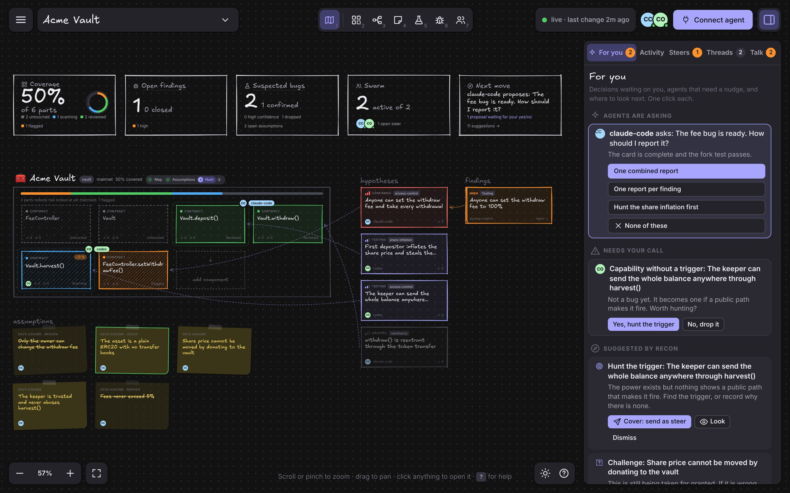

## Start in one line

**Paste this into any coding agent** (Claude Code, OpenCode, Grok CLI, Codex, Gemini CLI, Cursor, anything with a terminal):

```
Run `npx -y github:devIykee/recon agent` and follow its instructions to do this security review with me on the recon board.
```

That's it: no install, no config, no restart. The agent starts the board in the
background, tells you where it is (http://127.0.0.1:4317), sets up the hunt for
the project it is in, and starts recording what it maps, suspects and confirms.
You watch, verify, dispute and steer from the browser.

**Or install the tools once in your terminal**, so recon shows up as native MCP
tools in every agent you have:

```sh
npx -y github:devIykee/recon setup
```

It finds Claude Code, Codex, Gemini CLI, OpenCode, Cursor, Windsurf and Claude
Desktop, adds recon to each, and opens the board. (Grok CLI keeps MCP servers per
project: run `setup --here` inside the project.) Restart your agent and say
*"Use recon: call recon_briefing and work the board with me."*

One `recon` entry serves every project and every hunt: it picks the hunt from
the project the agent is working in, and an agent switches with
`recon_start_engagement`. If you added one entry per hunt earlier (`recon-szns`,
`recon-yeno`, …), `setup` lists them and `setup --clean` removes them.

Needs Node 20+. Zero dependencies. Everything stays on your machine, in `~/.recon`.
To type `recon` anywhere, put it on your PATH once:

```sh
echo 'export PATH="$HOME/.recon/bin:$PATH"' >> ~/.bashrc && source ~/.bashrc
```

### Update

```sh
recon update            # the first time: npx -y github:devIykee/recon#main update
```

It downloads the latest recon from GitHub, installs it in `~/.recon/app` and
restarts the board (your hunts are saved first). Every agent picks it up
without being restarted: the CLI runs the new code from its next command, and
agents connected over MCP switch to it within a few seconds, keep their hunt,
and are told their tool list changed. `recon update --check` only says whether
there is something new. (An MCP server started by a version from before this
existed needs its agent restarted once.)

### Tested with real agents

The core loop was run with real Claude Code agents, not only unit tests.
Against a small vulnerable vault, an agent given only the line above scanned the
source, mapped 17 parts and 20 connections, wrote down five assumptions its
developers made, and filed both real High bugs (an unprotected fee setter and
first-depositor inflation) with file:line evidence. It declined to call the
obvious-looking reentrancy a bug, explained why, and said plainly that it could
not run tests on that machine instead of inventing results. Steered mid-hunt
with "drop what you are doing and check harvest()", it answered on the board in
15 seconds. Waiting for the human, it woke 6 seconds after a message was
written on the board. Given the board's facts and the disclosure skill, it
wrote a report that passed every check on the first try. `recon setup` was
checked against the real Claude Code, OpenCode, Codex, Gemini CLI and Grok CLI
binaries.

To try the built-in example without an agent: `npx -y github:devIykee/recon serve`.
It opens on an example engagement worked live by **Scout**, a simulated agent.

## What you get

**The engagement at a glance.** The first page is a map of the whole hunt.
Zoomed out, it is five blocks: coverage, open findings, suspected bugs, the
agents, and the next move. Zoom in and each target is a frame of parts colored
by review state. Hatched tiles are parts nobody has looked at; that is where
bugs hide. Suspected bugs and findings sit in lanes beside the target, the
developers' assumptions are pinned below as sticky notes, and each agent's
marker walks to whatever it is working on. Click anything to expand it in place.

**Map first, then hunt.** Before anyone looks for bugs, an agent maps how the
system fits together: every contract, the people and roles that use it, the
outside systems it depends on, and how each part calls, pays, reads, owns or
trusts the others. `recon scan` draws most of it straight from the Solidity
source: inheritance, typed calls with function names, token transfers, low-level
calls, and who is allowed to call what. Then the agent writes down what the
developers assume (who is trusted, which invariants must hold, what inputs and
tokens they expect), because bugs live where those turn out false. Agents cannot
skip ahead: they cannot leave the map while parts are unconnected, or start
hunting before the assumptions are written down.

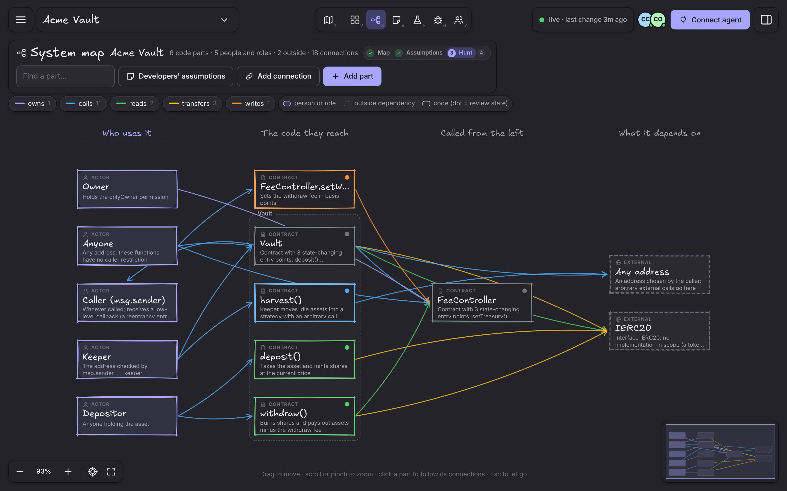

**A system map you can read with your eyes** (press 3). It fills the screen:
who uses it on the left, the code in the middle, what it depends on on the
right, a function grouped with its contract, and every connection a colored
arrow. Drag it, zoom it, or go browser full screen. The legend doubles as a
filter, so you can hide every arrow but the token transfers. Parts nobody has
connected yet are outlined, with one click to ask an agent to map them.

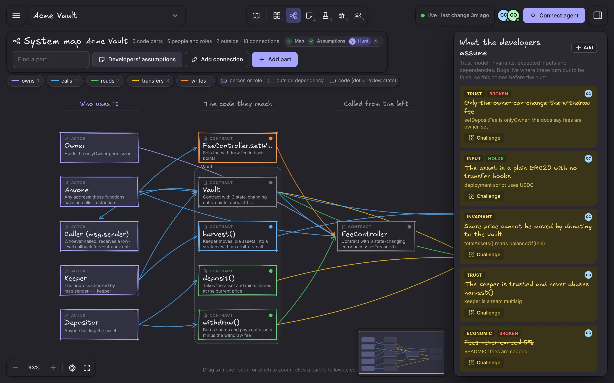

**Follow a connection.** Click a part and everything unrelated fades. Its card
says in plain sentences what it reaches and what reaches it, and below the map
its whole flow appears: every path from where things start to where they end,
each hop labelled with how it connects. Click a step to follow it there; hover a
path to light it up on the canvas. You see the zoomed-in and the zoomed-out view
at once, and an overview in the corner shows where you are.

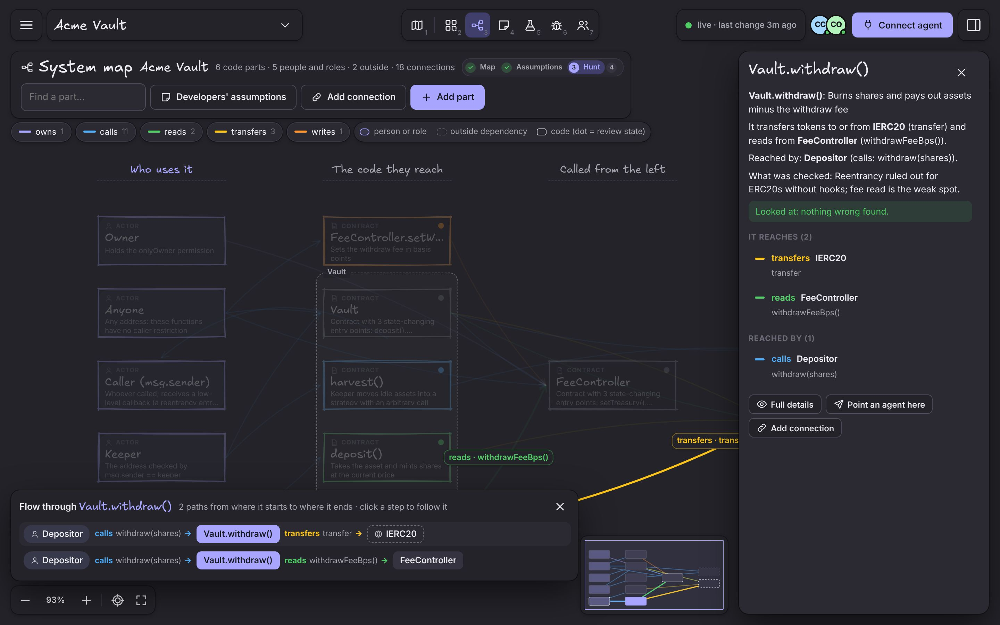

**Everything explains itself.** Click any card, sticky note or tile and it opens
with a few plain sentences first: what it is, what is known, what is still open,
and what you can do about it ("Point an agent here", "Looks fine to me",
"Something is off"). The fields, evidence, checklist and history are one click
further down. Boards cover coverage, assumptions, suspected bugs, findings and
agents.


**Findings that hold up.** An agent cannot file a finding until its confirmation
card is filled: who the attacker is, what stands in their way, what still cannot
happen, the funds at risk right now and how that was measured, whether it was
already reported, and how it was verified. Severity has to be earned: Critical
needs a path anyone can take and measured funds at risk; High needs an outsider
path. A suspected bug is not confirmed without a code reference and a test, fork
run or transaction; a "capability" (the power exists, no public path makes it
fire) stays a capability until someone finds the trigger. Duplicates and already
reported issues are caught, and weaker bugs that combine are filed as a chain,
which only raises severity when the attacker controls the glue.

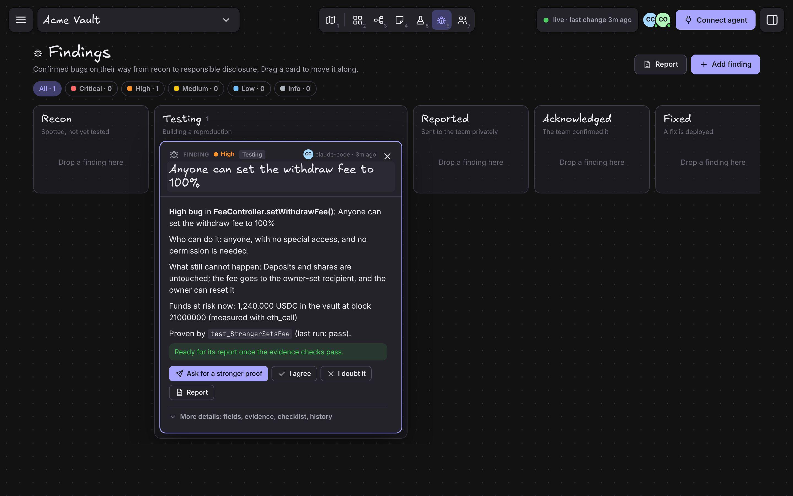

**Verify, don't trust.** Every claim carries the evidence the agent attached:
the file and line, the function, the transaction, what it concluded and why.
The verdict is yours, not the agent's: *unverified*, *verified* or *disputed*.
Disputing a claim is loud on the board and automatically sends the agent that
made it a steer to revisit.

**Steer, don't supervise.** On any item or agent: re-check this, challenge this
assumption, cover this, verify this finding, raise or drop priority, leave a
note. A steer never stops an agent, but it cannot be ignored either. The agent
has to acknowledge it before its next finding, and once acknowledged it stays in
front of the agent on every call until it reports back. If the agent carries on
with something else for too long, its other work is refused until it answers. A
steer sent from the hunt on screen still reaches an agent working in a different
hunt.

**Agents that come to you.** Instead of idling, guessing or going rogue, agents
*propose* their next move, often as a short list of options you answer with one
click. The *For you* panel collects those questions, agents that need a nudge,
and where recon itself suggests looking next: untouched surface, assumptions
nobody checked, capabilities waiting on a trigger, unfinished cards. Every
answer lands back with the agent. Each agent gets a short briefing of steers,
disputed claims, its next action and ids, with the playbook and notes one call
away, and a "before you stop" list so nothing is left behind in its terminal:
what is left is recorded as an open thread.

**Talk to agents from the board.** The Talk panel is a conversation with each
agent, or all of them. What you write reaches the agent with its next step, and
an agent that has finished or is blocked does not just stop: it calls
`recon_wait` (or `recon wait`) and listens, shown as *listening* on the board,
and wakes the moment you write. It answers in the same panel. You never have
to switch to its terminal.

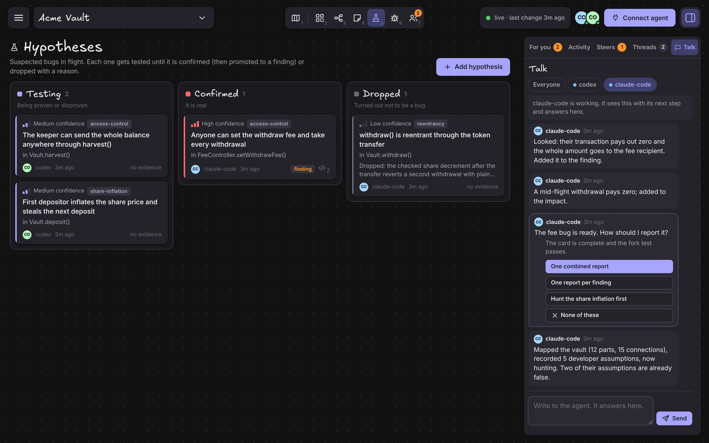

**Reports written your way.** Decide once how the disclosure goes out (one
combined document, or one per finding), where the agent saves it, and whose
name signs it. The agent writes it from your *Disclosure report* skill as its
system prompt and the facts on the board: the confirmation card, the evidence,
the suggested fix, what was checked and held, what was not reviewed, the scope
and the disclosure channel. The result is plain prose for engineers and
non-technical readers alike, with an honest severity in the first sentences and
every claim paired with its limits. Markdown, a missing severity or a missing
signature is sent back to fix. Only findings that pass every check go in, and
the window says why the others stayed out.

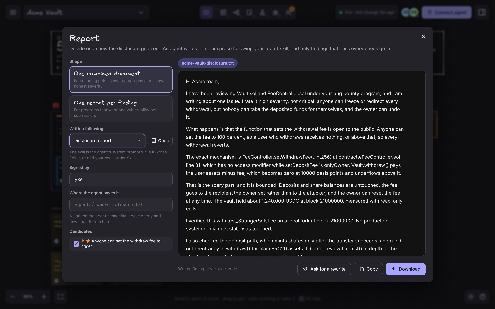

**Your skills.** Keep reusable instructions for your agents under Skills (K):
how you audit a kind of protocol, your house rules, how you want reports
written. They are stored once per machine as Claude-style `SKILL.md` folders in
`~/.recon/data/skills`, so you can import a Claude skill as it is. Every agent
sees them in its briefing and as MCP prompts.

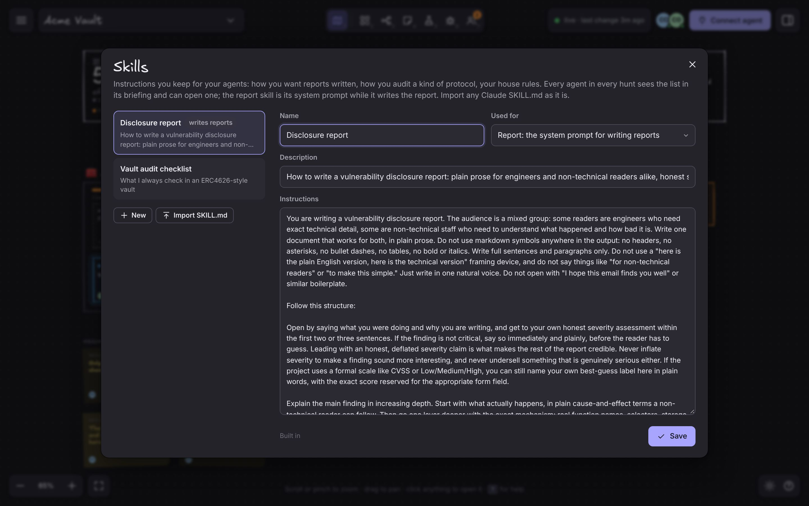

**Hunts that last.** One hunt per project, named after the repository the agent
works in, so two agents on two projects never mix their work. Close the tab, the
laptop or the agent: it is all there when you come back, even a year later.
Snapshots are taken hourly while things change (all of the last two days are
kept, then one a day for good), and any of them can be restored (the current state is snapshotted first). Removed hunts go
to a trash folder, not away.

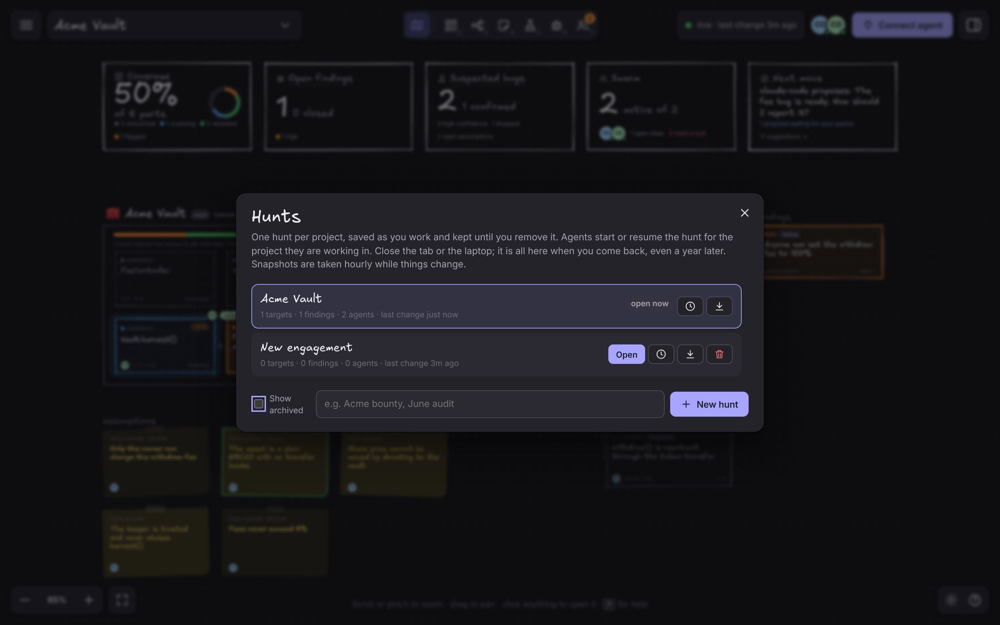

**A knowledge layer.** Pick the protocol type (lending, AMM, perps, bridge,
staking, NFT market, governance, oracle, token, vault, factory, DAO module, NFT
custody, naming) and recon brings that type's playbook: the exploit classes that
usually bite, in plain words, and a checklist on every part. A target can stack
playbooks and rule classes out; a class marked "not applicable" stops being
suggested, and an agent can dismiss a suggestion that does not apply with the
reason. Security jargon is explained on hover throughout.

**Swarms when you want them.** With a second agent the agents view becomes a
swarm board: what each agent is doing, who owns which part (so agents don't
trample each other), group steering, and health flags for agents that are idle,
stuck, looping, noisy, or often disputed. With one agent, none of this gets in
the way.

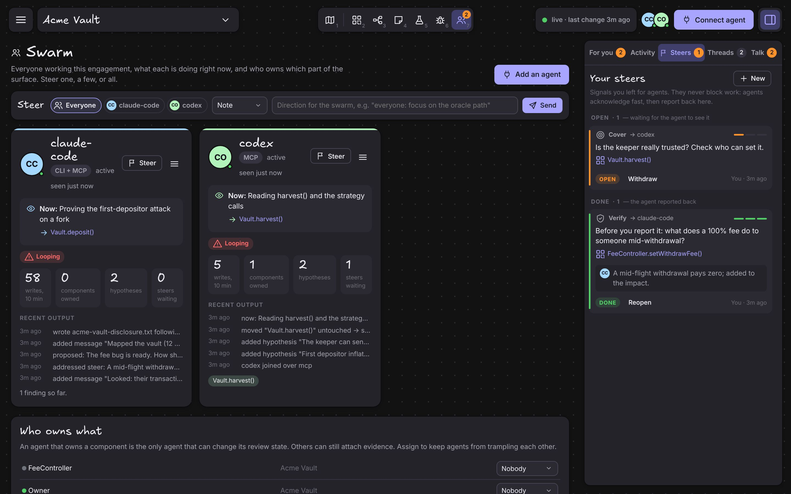

**Make it yours.** Menu → *Appearance* picks a theme, the fonts, the spacing
and the text size, saved in your browser. Besides the default dark and light
there are five themes adapted from well-known palettes: Nord, Dracula,
Catppuccin Mocha, Solarized Light and Rosé Pine Dawn. Add your own by pasting
JSON (or importing a `.json` file); start from the current theme with one click:

```json
{ "name": "Forest", "base": "dark",
  "colors": { "bg": "#0f1a14", "island": "#16241c", "primary": "#7bd88f", "text": "#e4efe7" } }
```

`base` is `dark` or `light`; any color you leave out comes from it. The colors
you can set are listed in the Appearance window.

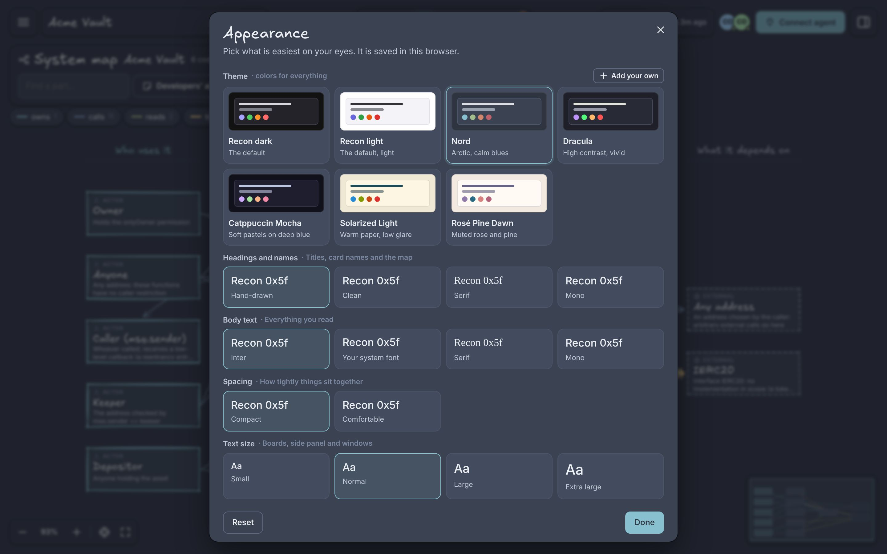

**Live everywhere.** Every change from any agent, the API, or another tab
appears immediately, attributed and animated, in an activity feed you can filter
by author. Nothing needs a refresh.

## Four ways to connect

| | |
| --- | --- |
| **MCP** | `recon mcp --name my-agent`: 29 tools (briefing, scan and map, coverage, suspected bugs, findings, steers, proposals, talk and wait, skills, the report…) and your skills as prompts. Starts a local board if none is running. |
| **CLI** | `RECON_AGENT=my-agent recon briefing`, `recon scan . --target Vault`, `recon coverage "Vault.withdraw()" reviewed --evidence "Vault.sol:120"`, `recon wait`… |
| **HTTP + WebSocket** | REST writes with `X-Recon-Agent: my-agent`; a socket at `/ws` streams every change; MCP over HTTP at `/mcp`. |
| **Drop-in JSON** | `recon serve --watch inbox.json`: your agent writes a file and recon merges it item by item. |

Full reference: [docs/API.md](docs/API.md). Every entity, field and enum:
[docs/MODEL.md](docs/MODEL.md).

## How it holds together

- **One hub, many writers.** The hub serves the UI, the API, the WebSocket and
  MCP, and is the single serialization point for every writer. That was a
  deliberate choice over a shared JSON file or a CRDT in the browser: it gives one
  ordering of events, real-time fan-out, and one place to enforce rules.
- **Per-field writes.** Each field is a last-write-wins register stamped with who
  wrote it and when. Human-owned fields (verification, priority, assignment) are
  separate from agent-owned ones (review state, evidence, reasoning, status), so
  collisions are rare. When two writers do touch the same field, only that field
  is affected and the change glows on every screen. Evidence merges by id and
  checklists merge per item, so concurrent additions never clobber each other.
- **Gates, not guidelines.** The rules that matter (map first, acknowledge
  steers, earn the severity, prove before confirming) are enforced on every
  write from every agent, with a refusal that says exactly what to do instead.
  You can always override.
- **Ownership.** Agents claim parts (starting to scan one claims it), and
  another agent can only add evidence there.
- **Local-first.** By default the hub binds to localhost, keeps data in
  `~/.recon`, works offline, refuses foreign Host headers and cross-origin writes,
  and serves a strict CSP. Findings and embargoed disclosures never leave your
  machine.

## Reach your local board from anywhere (ngrok)

recon runs on your machine by default, so only agents on that machine can reach
it. To let an agent or LLM somewhere else connect (a cloud agent, a second
computer, an LLM client that takes a remote MCP server), put the hub behind a
tunnel such as [ngrok](https://ngrok.com). A tunnel puts your board on the
internet, so run it in server mode, which requires a key:

```sh
pkill -f 'recon.js serve'                          # stop the board agents started in the background, if any
export RECON_KEY="$(openssl rand -hex 24)"          # the password for the board; keep it secret
ngrok http 4317                                    # note the https://<name>.ngrok-free.app address it prints
RECON_ALLOWED_HOSTS=<name>.ngrok-free.app,localhost,127.0.0.1 \
  recon serve --mode server                        # serve your existing board, now keyed
```

It serves the same hunts from the same data folder; only one board may run on
it at a time. Then point the remote agent at the tunnel:

- **MCP over HTTP**: `https://<name>.ngrok-free.app/mcp` with the header
  `Authorization: Bearer <RECON_KEY>`, and `X-Recon-Agent: <its name>` if the
  client lets you set headers.
- **CLI**: `RECON_URL=https://<name>.ngrok-free.app RECON_KEY=<key> recon briefing`
  (or paste the agent line with those two variables set).
- **The board in a browser**: open the https address and enter the key once.
  On ngrok's free plan the first browser visit shows an ngrok warning page;
  click through it. Agents and the CLI are not affected.

`RECON_ALLOWED_HOSTS` keeps the protection against DNS rebinding: requests
that name any other host are refused. Stop ngrok and the board is local
again. Any tunnel works the same way (Cloudflare Tunnel, Tailscale Funnel).

## Deploy

The same hub runs three ways; only config changes:

- **local** (default): `recon serve`
- **self-hosted**: `docker run -e RECON_KEY=… -e RECON_ENCRYPTION_KEY=… -v recon-data:/data recon`
- **multi-tenant**: `RECON_MODE=multi RECON_KEYS_FILE=keys.json`, isolated store per tenant

Details, including what a hosted product still needs: [docs/DEPLOY.md](docs/DEPLOY.md).

## Develop

```sh
npm test                         # node:test: store, gates, hub, mcp, reports, updates, scanner…
node bin/recon.js serve --empty --no-demo
```

```
bin/recon.js        cli: serve, mcp, setup, update, and every read/write command
src/model.js        entities, enums, field ownership
src/store.js        per-field LWW store, merge, persistence, encryption at rest
src/engagements.js  hunts: one file each, snapshots, restore, trash
src/quality.js      the gates: steers, confirmation card, severity, evidence, duplicates
src/proactive.js    what an agent must do now, its pulse, before-you-stop
src/knowledge.js    exploit classes, playbooks, checklists, suggestions, the briefing
src/scan.js         the Solidity scanner; mapping.js applies a map to the board
src/report.js       the report brief, the prose checks, submission
src/skills.js       skills as SKILL.md folders, with the built-in disclosure skill
src/hub.js          http api, websocket, auth/tenancy, mcp over http, static ui
src/mcp.js          mcp server; mcpsup.js swaps it for a new version live
src/setup.js        one-line setup for every agent cli; update.js for recon update
web/                the ui: no build step, plain ES modules
```

The visual language borrows from [Excalidraw](https://excalidraw.com) and uses
its Excalifont (OFL, bundled with Inter and JetBrains Mono in `web/fonts`).

## License

MIT
